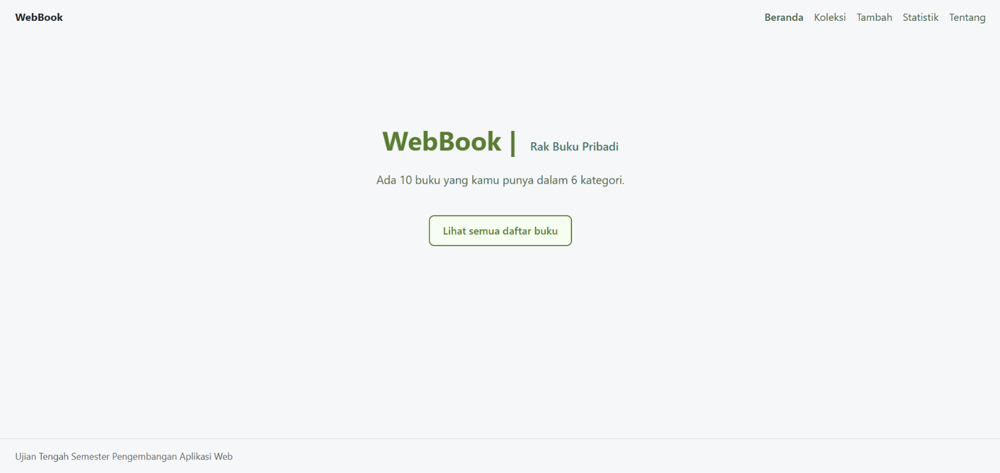

# Nama Aplikasi

**Nama:** Nafisya Ghalia
**NIM:** 124140100
**Kelas:** RB
**Tema:** Rak
**Deployment:** https://nafisya124140100-create.github.io/uts-paw/

## Fitur

- **Beranda:** Menampilkan ringkasan jumlah total buku dan jumlah kategori/status.
- **Koleksi:** Daftar buku dengan fitur pencarian real-time (berdasarkan judul) dan filter dropdown (berdasarkan status baca).
- **Detail Buku:** Menampilkan informasi lengkap buku (Judul, Penulis, Tahun Terbit, Kategori, Status) dan tombol untuk menghapus buku.
- **Tambah Buku:** Form input untuk menambahkan buku baru ke dalam koleksi dengan validasi sederhana (judul minimal 3 karakter).
- **Statistik:** Tabel jumlah buku berdasarkan kategori.
- **Tentang:** Halaman profil mahasiswa yang mengambil data secara dinamis dari file `mahasiswa.json`.

## Menjalankan secara lokal

cd app
npm install
npm run dev

## Konsep React yang Dipakai

- **Komponen (Component):** Memecah tampilan menjadi bagian-bagian kecil agar kode lebih rapi dan dapat digunakan kembali, seperti komponen `KartuItem` untuk menampilkan data buku dan `KotakPencarian` untuk fitur pencarian.
- **State Management:** Menggunakan `useState` untuk mengelola data lokal (seperti input form atau pilihan filter), serta Context API (`useKoleksi`) agar data daftar buku dapat diakses di berbagai halaman tanpa perlu meneruskan props secara manual.
- **React Router:** Mengatur navigasi antar halaman. Menggunakan `<Link>` untuk berpindah halaman, `useParams` untuk mengambil ID buku dari URL, dan `useNavigate` untuk mengarahkan pengguna secara otomatis setelah berhasil menambah atau menghapus buku.
- **Conditional Rendering:** Menampilkan antarmuka yang berbeda sesuai kondisi, misalnya menampilkan teks "Memuat data..." saat proses loading, pesan error jika gagal, atau "Tidak ada item yang cocok" jika hasil filter kosong.
- **List Rendering:** Menggunakan fungsi `.map()` untuk me-render daftar array, seperti menampilkan kumpulan kartu buku di halaman koleksi atau opsi-opsi di dalam dropdown.
- **Fitur JavaScript Modern:** 
  - Menggunakan `new Set()` untuk mendapatkan data yang unik, misalnya menghitung jumlah status atau kategori tanpa duplikat.
  - Menggunakan `.reduce()` untuk mengolah dan menjumlahkan data secara otomatis pada halaman Statistik.
